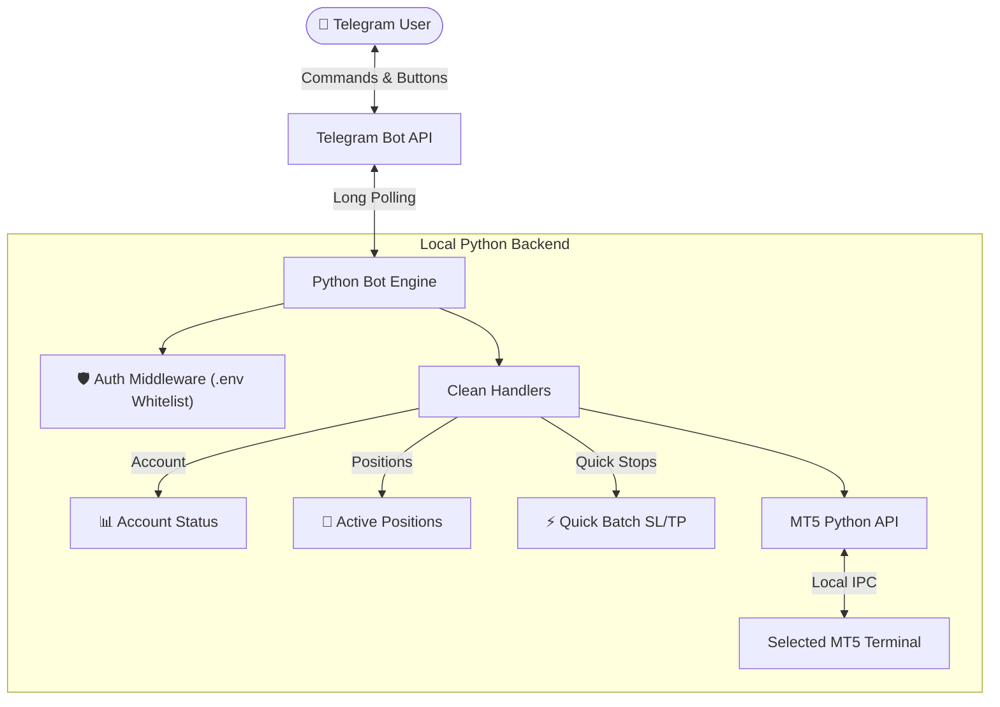

# 🤖 MT5 Telegram Trade Assistant

> **Streamlined, fast MetaTrader 5 position monitor and batch stop manager right from your phone through Telegram.**

[](https://www.python.org/)
[](https://github.com/python-telegram-bot/python-telegram-bot)
[](https://www.metatrader5.com/)
[](https://www.microsoft.com/windows)
[](LICENSE)

---

## 📖 What is this?

**MT5 Telegram Trade Assistant** is a lightweight, zero-bloat trading terminal that bridges your **MetaTrader 5** desktop platform with **Telegram**. 

Designed specifically for traders who need instantaneous monitoring and fast stop-loss / take-profit adjustments across their positions without the clutter:
- **📊 Account Status** — live balance, equity, margin level health bar, and floating P&L
- **💼 Active Positions** — live position list, individual trade cards, instant close, move to break-even, partial close, and direct pip stop adjustment
- **⚡ Quick Batch SL/TP** — ultra-fast batch stop price adjustment across multiple positions with 1-tap pair selection and instant portfolio risk calculation (`Float P&L`, `Total SL Risk`, `Total TP Target`)
- **🖥️ Multi-Terminal Selector** — automatic detection and interactive console selection for multi-broker MT5 installations

---

## ✨ Features

### 1. 📊 Account Status
- Real-time balance, equity, and floating P&L on `/start` or `/account`
- **Margin health bar** — visual 10-block indicator with `✅ Healthy / ⚠️ Warning / 🚨 CRITICAL` status
- Clear account mode identification (`Demo / Contest / Real`) and leverage

### 2. 💼 Active Positions
- Real-time snapshot of all currently open market positions
- Estimated risk & reward in account currency when SL or TP is set
- Per-position controls:
  - ❌ **Close Trade**: instant market close
  - 🥞 **Partial Close**: close 25%, 50%, or 75% of volume
  - 🛡️ **Move to BE**: move Stop Loss to entry price
  - ✏️ **Edit SL/TP**: click +/- 10-20 pip buttons or type custom prices

### 3. ⚡ Quick Batch SL/TP
- One-tap access directly on the **Home Page Inline Keyboard**
- **1-Tap Dynamic Pair Selector**: switch target pair with a single tap (`[All] [XAUUSD] [EURUSD]`)
- **Multiple Entry Modes**:
  - **Quick Type (Fastest)**: send `2740.50 2790.00` (SL & TP) or `gold 2740.50 2790.00`
  - **Guided Step-by-Step**: prompts for SL first, then TP, with skip buttons
  - **SL Price Only / TP Price Only**: modify or clear one stop level without touching the other
  - **🛡️ Move to Break-Even**: moves winning trades to entry immediately
  - **❌ Clear Stops**: clears all stops across target positions
- **🛡️ Live Portfolio Risk Metrics**: every update displays real-time:
  - 📊 **Float P&L**
  - 🔴 **Total SL Risk**
  - 🟢 **Total TP Target**

### 4. 🖥️ Interactive Multi-Terminal Scanner
- Automatically scans running and installed MT5 terminals (`terminal64.exe`) across standard and custom broker directories
- Prompts you at startup to choose which terminal/account to connect to, or `[0] ❌ Quit / Exit`

### 5. 🔊 Authentic PC Audio Alerts & Deal Watcher
- **Local PC/Laptop Speaker Alerts**: Plays authentic MT5 chimes (`ok.wav`, `stops.wav`, `alert2.wav`) along with crystal-clear voice announcements (*"Order filled"*, *"Position closed"*, *"Take profit hit"*, *"Stop loss hit"*).
- **Background MT5 Deal Watcher**: Automatically monitors MT5 deal settlements in the background and plays the corresponding PC sound whenever a Take Profit, Stop Loss, or Order Fill occurs, without spamming your Telegram chat.
- **Bot Action Hooks**: Immediate sound feedback on button clicks (close trade, partial close, break-even, quick stops).
- **Test Command**: Run `/sound` or `/testsound` in Telegram to test your speaker output anytime.


---

## 🏗️ Architecture



---

## 🚀 Quick Setup

### 1. Requirements
- Windows 10/11 64-bit
- Python 3.10+
- MetaTrader 5 Terminal installed

### 2. Installation
```powershell
# Clone the repository
git clone https://github.com/usmanch96/mt5-telegram-trade-assistant.git
cd mt5-telegram-trade-assistant

# Install dependencies
pip install -r requirements.txt
```

### 3. Configuration
Copy `.env.example` to `.env`:
```ini
TELEGRAM_BOT_TOKEN="your_bot_token_from_botfather"
AUTHORIZED_USERS="your_telegram_id"
```

### 4. Run
```powershell
python main.py
```
Upon startup, the bot will scan for installed MT5 terminals and present an interactive menu to choose which broker/terminal to connect to.
