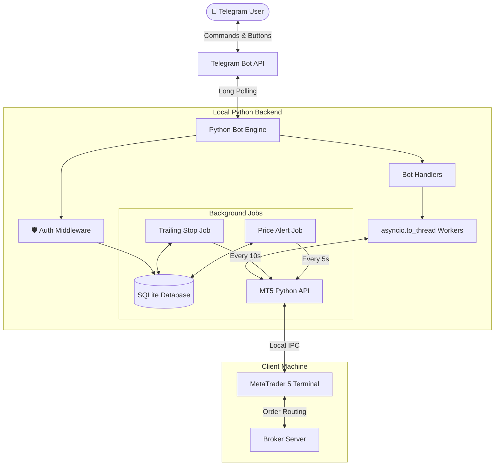

# 🤖 MT5 Telegram Trade Assistant

> **Control MetaTrader 5 from your phone — execute trades, manage positions, set trailing stops, and monitor your account in real time through a professional Telegram bot interface.**

[](https://www.python.org/)
[](https://github.com/python-telegram-bot/python-telegram-bot)
[](https://www.metatrader5.com/)
[](https://www.microsoft.com/windows)
[](LICENSE)

---

## 📖 What is this?

**MT5 Telegram Trade Assistant** is a self-hosted Python trading terminal that bridges your **MetaTrader 5** desktop platform with **Telegram**. Instead of being chained to your desk, you control your trades from anywhere — opening positions, managing stops, firing layered entries, or closing everything in an emergency — all through a polished mobile interface.

Built for serious retail traders who want:
- **Speed** — one-tap actions instead of navigating MT5 menus under pressure
- **Control** — granular per-position and bulk batch controls
- **Safety** — whitelist-only access, confirmation screens, and validated order logic

---

## ✨ Feature Highlights

### 🛡️ Security & Access Control
- **Whitelist-only** — bot ignores every message from unlisted Telegram IDs
- **Dynamic authorization** — `/authorize` and `/revoke` commands to manage users at runtime without restarting
- **Inline callback guard** — unauthorized users cannot trigger actions even by replaying button callbacks

### 📊 Live Account Dashboard
- Real-time balance, equity, and floating P&L on `/start`
- **Margin health bar** — visual 10-block indicator with `✅ Healthy / ⚠️ Warning / 🚨 CRITICAL` status
- Trade mode clearly labeled (`Demo / Contest / Real`) instead of raw MT5 integer codes

### 🚀 Trade Execution Wizard
- Guided step-by-step flow: Symbol → Direction → Lot Size → SL → TP → Confirm
- **Risk-based lot calculator** — enter a risk `%` of equity + SL price and the exact lot size is computed
- **R:R Take Profit presets** — auto-calculate TP at 1:1, 1:2, 1:3 risk-to-reward
- **Order Ticket confirmation card** — shows estimated risk in account currency before firing

### 💼 Single Position Management
Per-position controls from a detailed trade card:
| Action | Description |
|--------|-------------|
| ❌ Close Trade | Full instant close at market |
| 🥞 Partial Close | Close 25% / 50% / 75% of volume |
| 🛡️ Move to BE | Shift SL to exact entry price |
| ✏️ Edit SL/TP | Bump in pip increments or type custom levels |
| 📈 Set Trailing Stop | Preset pip distances or custom input |

### ⚡ Batch Emergency Controls
Bulk operations filtered dynamically by symbol and lot size:
- **🚨 Close All Positions** — nuke the entire book
- **Close Profit Only / Close Loss Only** — selective pruning
- **Move All to Break-Even** — protect all running profit
- **Batch Edit SL/TP** — redefine stops across the book in bulk
- **Batch Trailing Stop** — apply trailing to all positions with presets
- **Cancel Pending Orders** — remove queued limit/stop entries in bulk

### 🥞 Progressive Layering (Scale-In Grid)
Place multi-layer entries across a price zone automatically:
- Layer 1 fires as a market order; Layers 2+ placed as GTC pending limits
- Auto-calculates equal spacing from entry to SL across all layers
- Equal lot distribution with broker minimum lot validation
- Visual **grid execution matrix** on confirmation, then a per-layer `✅/❌` result report

### 🔔 Automations (Background Services)
- **Price Alerts** — set any price target; bot auto-detects ABOVE/BELOW direction and fires a Telegram message the moment price crosses
- **Trailing Stop Service** — polls every 10 seconds and moves SL to trail current price once minimum profit is reached

---

## 🏗️ System Architecture



---

## 📂 Project Structure

```
MT5-Telegram-Bot/
├── bot/
│   ├── conv_filters.py         # Shared conversation handler filters (prevents menu button leaks)
│   ├── keyboards.py            # All InlineKeyboard and ReplyKeyboard layout builders
│   ├── middleware.py           # @restricted decorator for whitelist enforcement
│   ├── main.py                 # Application builder, handler registration, background jobs
│   └── handlers/
│       ├── account.py          # Welcome screen, live account dashboard
│       ├── trade.py            # Multi-step trade execution wizard
│       ├── positions.py        # Single position controls and modification wizard
│       ├── batch.py            # Batch emergency controls panel
│       ├── layer.py            # Progressive layering wizard
│       └── alerts.py           # Price alert creation and management
├── mt5/
│   ├── connector.py            # MT5 terminal session and health checks
│   ├── monitor.py              # Account info, position queries, symbol data
│   ├── executor.py             # Market orders, pending orders, close, modify stops
│   └── risk_calculator.py      # Lot size calculation from risk % and SL distance
├── services/
│   ├── trail_service.py        # Background trailing stop adjustment loop
│   ├── alert_service.py        # Background price alert checker loop
│   └── logger.py               # Structured logging setup (fresh log on each run)
├── database/
│   ├── db_manager.py           # Thread-safe SQLite context manager
│   └── models.py               # SQL queries: whitelist, price alerts, trailing stops
├── config/
│   └── settings.py             # .env loader and validated settings object
├── tests/
│   └── test_mt5.py             # MT5 connection verification script
├── .env.example                # Environment variable template
├── requirements.txt            # Python dependency manifest
├── run.bat                     # One-click Windows launcher
└── main.py                     # Entry point
```

---

## ⚙️ Setup & Installation

### Prerequisites
| Requirement | Notes |
|-------------|-------|
| **Windows OS** | MetaTrader 5 Python bindings are Windows-only |
| **Python 3.10+** | Must be added to system PATH |
| **MetaTrader 5** | Desktop terminal installed and logged into your account |
| **Telegram Bot Token** | Create a bot via [@BotFather](https://t.me/BotFather) |

### Step 1 — Clone the repository
```powershell
git clone https://github.com/YOUR_USERNAME/mt5-telegram-trade-assistant.git
cd mt5-telegram-trade-assistant
```

### Step 2 — Install dependencies
```powershell
pip install -r requirements.txt
```

### Step 3 — Configure environment
Copy the template and fill in your credentials:
```powershell
copy .env.example .env
```

Open `.env` and set:
```ini
# Telegram
TELEGRAM_BOT_TOKEN=your_bot_token_from_botfather
AUTHORIZED_USERS=123456789,987654321   # Your Telegram numeric user ID(s)

# MetaTrader 5
MT5_LOGIN=12345678
MT5_PASSWORD=your_mt5_password
MT5_SERVER=Exness-MT5Trial16           # Your broker server name

# App
DB_PATH=database/trading_bot.db
LOG_LEVEL=INFO
```

> 💡 Get your Telegram numeric ID by messaging [@userinfobot](https://t.me/userinfobot)

### Step 4 — Verify MT5 connection
```powershell
python tests/test_mt5.py
```
This script connects to your running MT5 terminal, authenticates, and prints account stats. Fix any errors here before starting the bot.

### Step 5 — Run the bot
```powershell
python main.py
```
Or double-click **`run.bat`** on Windows.

Open Telegram, start a chat with your bot, and send `/start`.

---

## 🤖 Bot Commands

| Command | Description |
|---------|-------------|
| `/start` | Open main menu with live account snapshot |
| `/menu` | Alias for `/start` |
| `/account` | Jump directly to account status dashboard |
| `/trade` | Start the trade execution wizard |
| `/cancel` | Abort any active wizard (trade, layer, edit, alert) |
| `/authorize <user_id>` | Add a user to the whitelist *(admin only)* |
| `/revoke <user_id>` | Remove a user from the whitelist *(admin only)* |

---

## 🔑 Key Technical Decisions

### Async + Blocking MT5 Calls
MetaTrader 5's Python library makes synchronous blocking I/O calls. Calling them directly inside `async` PTB handlers would freeze the entire event loop. All MT5 calls are offloaded using `asyncio.to_thread()` to keep the bot responsive.

### ConversationHandler State Leak Prevention
Persistent reply-keyboard buttons (e.g. `📊 Dashboard`) share the same message channel as wizard text inputs. A shared `NOT_MENU_BUTTON` filter in `bot/conv_filters.py` excludes known button labels from all conversation state `MessageHandler` registrations — preventing menu presses from being misinterpreted as wizard inputs.

### Broker-Agnostic Order Filling
MT5 brokers differ in their supported order filling modes (`FOK`, `IOC`, `RETURN`). `mt5/executor.py` inspects the `type_filling` bitmask on `symbol_info` at order time and selects the correct mode automatically, avoiding `TRADE_RETCODE_UNSUPPORTED_FILLING` (10030) errors.

### Thread-Safe SQLite
SQLite is not safe for concurrent writes from multiple threads. `database/db_manager.py` wraps every query in a `threading.Lock`-guarded context manager, ensuring the trailing stop service and alert service don't corrupt state when running concurrently.

---

## 📦 Dependencies

| Package | Version | Purpose |
|---------|---------|---------|
| `python-telegram-bot[job-queue]` | ≥ 20.8 | Telegram Bot API framework with JobQueue support |
| `MetaTrader5` | ≥ 5.0.4500 | Official MT5 Python bridge (Windows only) |
| `python-dotenv` | ≥ 1.0.1 | `.env` file loader |
| `pandas` | ≥ 2.0.0 | Data handling for position/order processing |

---

## 👤 Author & Contact

Developed by **M Usman**
- 💬 **Telegram**: [@usmanch069](https://t.me/usmanch069)
- 🐛 **Issue Tracker**: Feel free to open an issue or reach out directly for feature requests and support.

---

## ⚠️ Disclaimer

This software is provided for **educational and personal use only**. Trading financial instruments carries significant risk of loss. The authors are not responsible for any financial losses incurred through the use of this software. Always test on a **demo account** before using with live funds.

---

## 📄 License

This project is licensed under the **MIT License**. See [LICENSE](LICENSE) for details.

